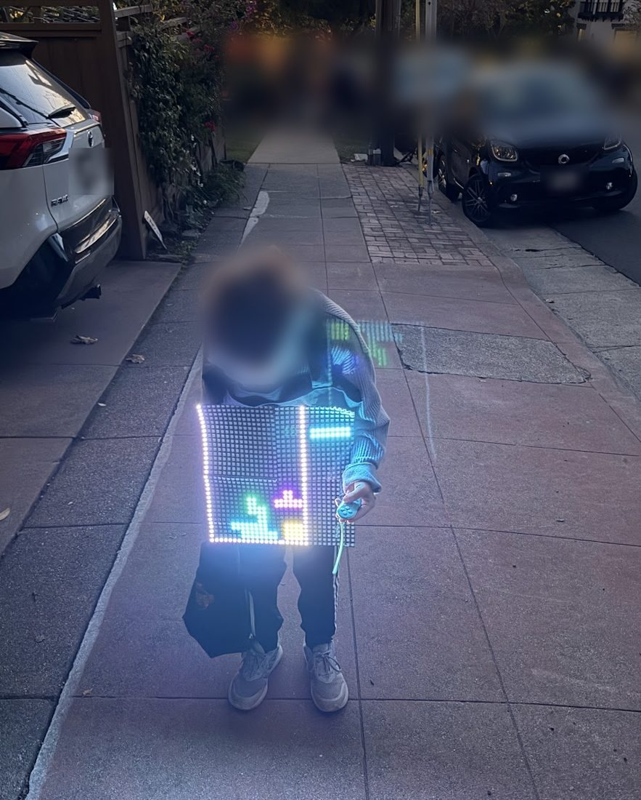
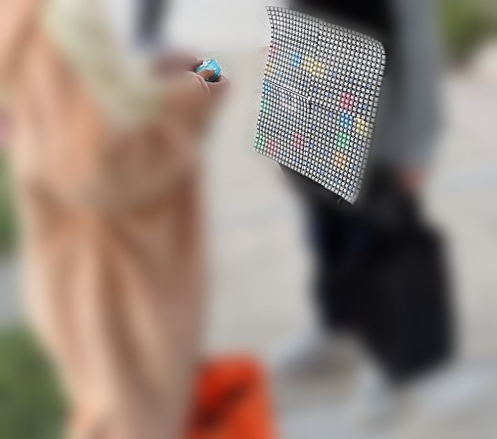
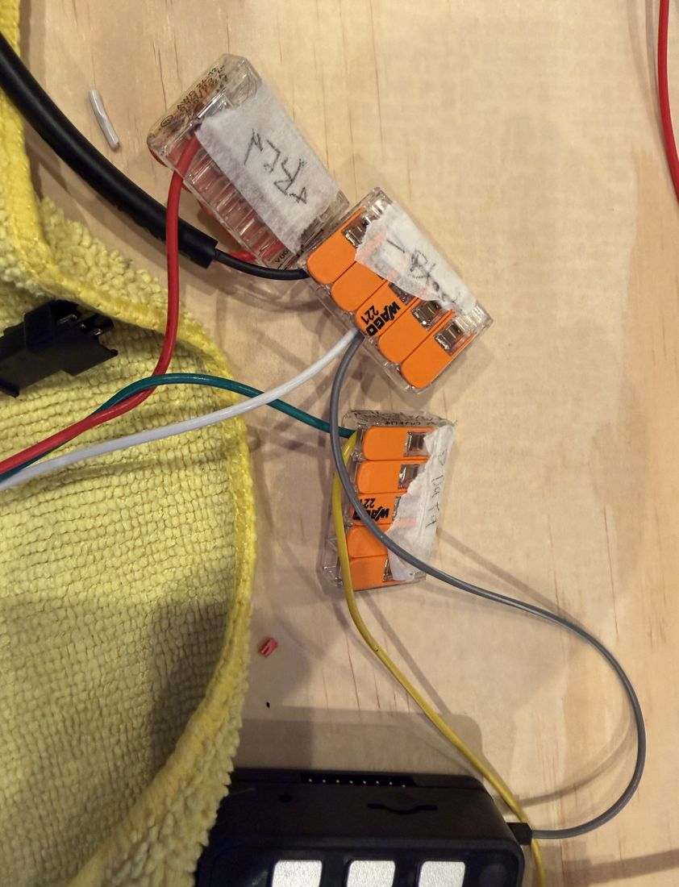
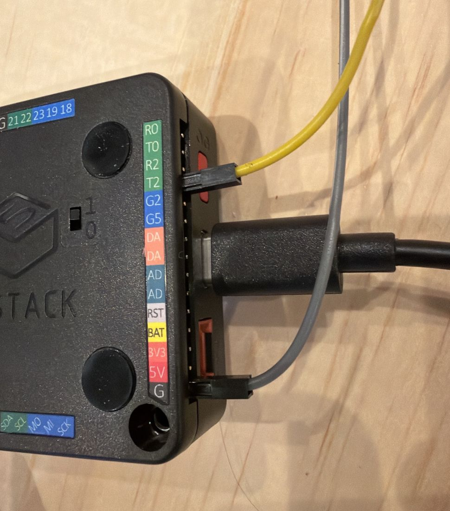
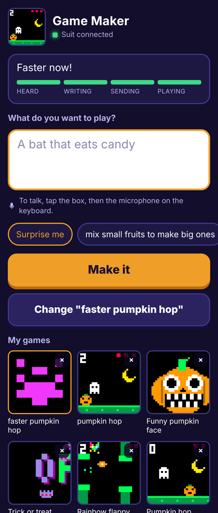
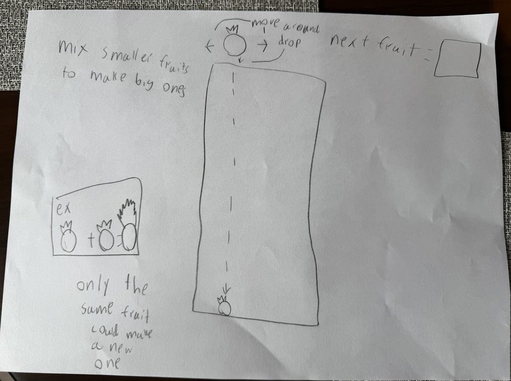
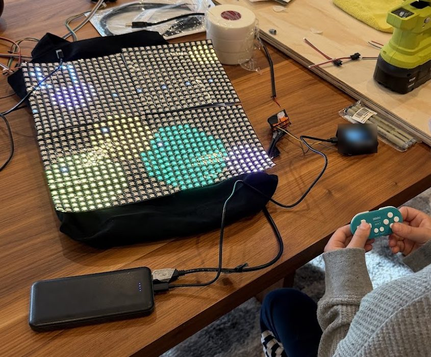

# Arcade Suit

*A 32 x 32 LED arcade you can wear. Two games built in. Or say a game out loud and Claude writes it onto your chest.*



## The idea

My 8-year-old had an all-black bodysuit and wanted lights on it. Six days before Halloween I asked Claude for something we could build that afternoon. Ten minutes later he wanted to be checkered. Five minutes after that I asked if he could become a playable video game. Then he asked for a falling-block game.

Idea to checkout took 36 minutes. The build took the rest of the week, and most of that was three wires.

It ran its two built-in games, Maze and Blocks, at the school parade. For Halloween we added Magic mode: he comes up with a game, I say it into my iPhone, Claude writes it, and it shows up on his shirt.

We built it to be interactive. The screen faces out and the controller is wireless, so other kids could play him. He stood on the sidewalk being the arcade while they took turns.

Note: I'm a non-technical lawyer. I can't really code. Claude wrote all the firmware, the guides and most of this README. Full disclosure: I work at Anthropic. This is a personal project, not an Anthropic product.



## Buttons

| Button | Menu | Maze | Blocks | Made-up games |
|---|---|---|---|---|
| D-pad | Pick a tile | Steer | Move. Up rotates. | Whatever Claude decided |
| A / B | Start | | Rotate / drop | Usually the action |
| Select | | Menu | Menu | Menu |

A and B are what Bluepad32 calls A and B. I am not sure the letters printed on the 8BitDo match. Press both and see. With no controller, the three M5Stack buttons work as left, A and right.

## BOM

You can do it for around $100 if you already have a controller, a battery pack and some wires. I had a lot of this lying around. Prices are from October 2026.

| Qty | Description | ~Price | Notes |
|---|---|---|---|
| 2 | BTF-LIGHTING WS2812B ECO 16x16 flexible panel, 2-pack | $29.99 each | Four panels, about 32 cm square. They click together. |
| 1 | M5Stack Basic v2.7 | $60.53 with tax | Must be a classic ESP32. The controller needs old-style Bluetooth. Jumpers and USB-C cable in the box. |
| 1 | 8BitDo Zero 2 | about $20 | |
| 1 | Anker 10,000 mAh power bank | $29.04 with tax | Needs one USB-A and one USB-C port. |
| 1 | WESIRI 3-pin JST-SM connectors, 10 pairs | $6.49 | Used one. |
| 1 | YouthZeal USB-A to bare wire cable, 18 AWG, 5-pack | $9.99 | Used one. |
| 1 | WAGO 221-415 clear lever nuts, 10-pack | | Used three. Clear, so you can see the copper. |
| 1 | Klein 11046 wire stripper | $16.24 | |
| | Electrical tape, paper tape, a marker | | Strain relief, seams, labels. |
| | Multimeter, black tote bag, fanny pack | had them | The tote is a Keep Thinking bag from the Code with Claude conference. The handles go around the neck. Brain and battery ride in the fanny pack. |
| | 3D printed backing board, Velcro, tape, glue | had them | The board keeps the screen flat. Velcro, tape and glue hold it to the tote. |
| | iPhone hotspot and a Claude API key | $5 of credit | Magic mode only. |

**Bought and did not need:** grey lever connectors ($8.99, the villain of this story), Grove cables ($9.40), 1N5408 diodes (about $6, a plan B for a weak signal that turned out fine). **Never needed:** a soldering iron, a level shifter, a microphone.

## 1. Wire it

Three nuts, seven wire ends.


| Nut | What goes in |
|---|---|
| **+ RED** | Power cable red. Panel plug red. |
| **- BLACK** | Power cable black in one hole. Panel plug white, twisted with the M5Stack's grey jumper, in another. |
| **D DATA** | Panel plug green, twisted with the M5Stack's yellow jumper, in one hole. |

**The twist-together trick.** This is the whole project in one paragraph. The jumpers that come with the M5Stack are too thin for a WAGO to grip. Put one in a hole by itself, close the lever, and it looks perfect and touches nothing. Twist the thin wire and the fat wire into one strand and put that in one hole. Our panel lit up on the first try after two evenings of nothing.

**Pins.** Yellow on `T2` (GPIO 17), grey on `G`, on the row of gold pins beside the USB-C port. The other side has sockets. The same signal also comes out of 16, 2, 5 and 26, so one pin off still works.

**Panels.** From the back: 1 top left, 2 top right, 3 bottom right, 4 bottom left, bottom pair upside down. OUT clicks into IN. Trust the arrows printed on your panels, not a drawing. Paper tape on the seams and over any loose bare ends.

**Test after each step.**

1. Strip about 11 mm off all seven ends.
2. Fill + RED and - BLACK, no M5Stack yet. Plug into the bank's USB-A port. The meter should read 5 V across the nuts. If it reads 0, press the bank's button.
3. Add grey and yellow with the twist. Jumpers onto G and T2.
4. Plug the M5Stack into the bank's USB-C port and leave it there. Its own battery lasts under an hour.

 

## 2. Build the firmware

```sh
./docker-build.sh
```

It compiles `arcade_suit/` in a container with pinned versions (Bluepad32 core 4.1.0, FastLED 3.6.0, M5Unified and M5GFX 0.1.17) and applies one small patch so a phone that walks away mid-upload cannot freeze the suit. Output lands in `build/`.

No prebuilt binaries. Bluepad32 links BTstack, which is free for open source projects and commercial otherwise, so I would rather you build your own.

Tip: put your own hotspot's name and password in `arcade_suit/config.h` first. It saves a setup dance later. See section 6.

## 3. Flash it

1. Slide the tiny switch under the M5Stack to **1**. At 0 it dies the moment you unplug it. Ask me how I know.
2. In Chrome, open [esptool-js](https://espressif.github.io/esptool-js/), click Connect, pick **USB Single Serial**.
3. Change the address from `0x1000` to `0x0`. It resets every time.
4. Choose `build/arcade_suit_flash_at_0x0.bin`, click Program.
5. Click Disconnect, then press the red side button.

That wipes the pairing, panel setup and Wi-Fi. For updates, flash `build/arcade_suit.ino.bin` at `0x10000` and they survive.

## 4. Line up the panels

You should get a color test, then a checkered menu. If the picture is scrambled: controller off, hold the left and right M5Stack buttons for 2 seconds. Each panel shows its number.

| M5Stack button | Tap | Hold 1.5 s |
|---|---|---|
| Left | Next panel | Turn the whole picture a quarter turn |
| Middle | Rotate this panel | Save and leave |
| Right | Switch rows and columns | Next layout |

## 5. Pair the controller, and wear it

Hold **B + Start**, then **Select** for 3 seconds. After that, Start alone reconnects.

Put a stiff board behind the screen. Ours is 3D printed. Fix it to a black tote bag with Velcro, tape and glue. Ours is a Keep Thinking tote from the Code with Claude conference. Tape every lever shut. Tape each cable to its neighbor an inch from the nut, so a tug pulls tape and not copper. Leave slack. Brain and battery go in a fanny pack. Then jump up and down 10 times. Nothing should flicker.

## 6. Magic mode

### How the pieces connect

```
   you  --talk-->  your phone  --cellular-->  Claude
                      |   ^
                      |   |   your phone's own Wi-Fi hotspot
                      v   |
                    the suit
```

- Your phone makes a Wi-Fi network (Personal Hotspot). The suit joins it.
- The suit serves one web page on that network. Your phone opens it.
- That page asks Claude for the game over the phone's cellular connection, then hands the game to the suit.

No router, no server, no account for the suit. There are no passwords in this repo. You bring your own.

### Set up your network

1. **Pick your own hotspot password.** iPhone: Settings > Personal Hotspot > Wi-Fi Password.
2. **Find your hotspot's name.** It is the phone's name: Settings > General > About > Name.
3. **Turn on** Allow Others to Join and **Maximize Compatibility**. The suit only speaks 2.4 GHz Wi-Fi, and that switch is what turns it on.
4. **Tell the suit the name and password.** Two ways:
   - **Before you build (easiest).** Fill in `HOTSPOT_NAME` and `HOTSPOT_PASS` in `arcade_suit/config.h`. Do not commit that file anywhere public.
   - **After, with no rebuild.** Pick the sparkle tile. The chest says SET UP WIFI and the suit starts its own little network, `ArcadeSuit`. Each suit makes up its own password on first boot and shows it on the M5Stack's screen. Scan the Step 1 code to join, scan the Step 2 code to open the page, then Grown-up settings > Look for networks > pick yours > type the password > Save and join.
5. **Stay on the Personal Hotspot screen** until the chest says ASK ME 4 GAME. An iPhone only lets a new gadget join while that screen is open.

To switch networks later: controller off, hold the right M5Stack button for 3 seconds in Magic mode.

Android hotspots and home Wi-Fi should work too, as long as it is 2.4 GHz and the phone and the suit are on the same network. I have only tried an iPhone.

### Make a game

1. Get a key from the [Claude Console](https://platform.claude.com/settings/keys). Personal account, its own workspace, a $5 limit. Delete it when the candy is gone.
2. Scan the code on the M5Stack's screen. The page opens in Safari.
3. Paste the key under Grown-up settings. It stays in that browser.
4. Tap the box, tap the keyboard's microphone, say the game, tap **Make it**.



### The first game came with a design doc



I read it into the phone. It was not instant and it was not clean. The page said "Oops, fixing a little bug" twice and the Wi-Fi dropped halfway. At 4:11 pm on Halloween the phone said "Match two of the same fruit to grow a bigger one!" Then there were fruits. `gamemaker/games/f1_fruit.lua` is a remake from the same sheet of paper.



## How it works

The kid has an idea. A grown-up says it into the iPhone keyboard's microphone. The M5Stack has joined the phone's hotspot and serves one plain web page. That page calls Claude straight from the browser with `gamemaker/prompt.txt`, which describes the machine: 32 x 32 pixels, 16 colors, six buttons, hardly any memory. Back comes one cheerful sentence and one program under 6,000 characters, written in Lua, a small programming language that fits on tiny computers. The page uploads it, and the M5Stack runs it in a sandbox at 25 frames a second.

- **If the game breaks,** the error text goes back to Claude. Three tries, then it asks you to say it a different way.
- **The sandbox** allows drawing, six buttons and math. 20 KB of memory, 300,000 steps per frame, no files, no network.
- **Memory** is the hard part. Bluetooth, Wi-Fi and 1,024 LEDs leave about 45 KB, in pieces. Claude grabs one 20 KB block first, uses an allocator with no per-item overhead, and loads functions on first use. If a game still does not fit, Wi-Fi switches off while it plays. Select brings it back.
- **The prompt** says cartoon spooky only, nothing mean, no copying famous characters, and if an ask is not OK for a kid, make the closest friendly version.
- **`web/`** is the same C++ compiled to WebAssembly, unchanged. The tests run on it.

## What I learned

1. **Send photos of your actual parts before anyone draws anything.** Claude drew three guides from typical panels. Ours had different wire colors, and IN and OUT were swapped.
2. **If you cannot see the copper, you do not know.** The grey connectors were gripping plastic or air. They looked fine.
3. **Meter first, LEDs second.** Two numbers (5 V on power, 0.02 V on signal) told us which half was solved.
4. **Freeze the guide once you start building.** I asked for new colors and got a whole new booklet while I was on page 19 of the old one.
5. **Frozen colors mean a dead brain, not dead panels.** LEDs hold their last color. Ours froze mid-test the night before the parade because the M5Stack's tiny battery died.
6. **Simulate what you can. Hardware gets the last word.** Magic mode passed 30 sample games, 26 nasty programs and 12 phone scenes before it touched the board. It still had five bugs by dinner.
7. **Keep a boring mode.** Maze and Blocks need no Wi-Fi, no phone and no Claude.

## When it doesn't work

| What you see | Do this |
|---|---|
| M5Stack black after flashing | Flash at `0x0`. Click Disconnect, replug, press the red button. |
| M5Stack dies when unplugged | Bottom switch to 1 |
| 0 V at the nuts | Press the bank's button. Look for copper inside the nut. |
| 5 V at the nuts, panels dark | The twist. Then check the plug is on Panel 1's IN. |
| Panels stuck on one solid color | The M5Stack lost power. Plug it into the bank's USB-C port. |
| Controller will not reconnect in Magic mode | The suit rests its Wi-Fi and shows PRESS START. Press Start. |
| Stuck on WIFI | Open the iPhone's Personal Hotspot screen and wait |
| Wrong network saved | Controller off, hold the right M5Stack button 3 s in Magic mode |

## Fair warnings

- **This exact build has never run on the costume.** What we wore had my kid's name in it. This one has the names out, a redesigned phone page, one new endpoint (`/screen`), and a simpler Wi-Fi setup that only joins a network you name. It compiles and passes every test here. It has not been flashed. I have not run `docker-build.sh` either. Claude built the firmware in its own sandbox with the same pinned versions.
- **The hotspot is the weak link.** At 5:16 pm on Halloween we were stuck on the Wi-Fi screen. Phones in pockets lock, and costumes walk out of range. I never properly fixed this.
- **The API key sits in the phone's browser storage,** on a page served over plain HTTP on your hotspot. It only ever goes to api.anthropic.com over HTTPS. Still: small limit, short life.
- **A grown-up runs the phone.** It is your API key and your account, so you are the one using Claude. That is how we did it: his ideas, my phone. The prompt keeps things friendly, but it is a prompt, not a guarantee.
- **1,024 LEDs can pull far more current than these wires should carry.** The firmware holds brightness at 20 of 255 and caps the LEDs at about 1 A. It is plenty at night. Think before you raise it.
- I am not an engineer. This is a battery and bare copper on a child. Tape everything, check for warmth, use a name-brand power bank, and charge it.

## Repo layout

```
arcade_suit/      the Arduino sketch
  config.h        your hotspot's name and password go here. Empty by default.
  games.h         menu, Maze, Blocks. No hardware code, so it also runs in a browser.
  luagame.h       the Lua sandbox and drawing commands
  arena.h         the 20 KB allocator
  magic.h         Wi-Fi, web server, saved game, waiting screens
  page.h          the phone page, generated. Do not edit.
  src/lua/        Lua 5.4.6, trimmed. See its README.
gamemaker/        the prompt, the phone page, build_page.py, and 31 sample games
web/              the same engine as WebAssembly, and the engine tests
test/             a pretend iPhone, suit and Claude. 26 nasty programs. An allocator fuzzer.
patches/          two time limits for the stock ESP32 web server (LGPL, see its README)
docs/             photos and the wiring diagram
```

```sh
node web/test.js          # every sample game, every nasty program
node test/page.test.js    # the phone page, 12 scenes (needs playwright)
```

## Standing on shoulders

[Bluepad32](https://github.com/ricardoquesada/bluepad32) by Ricardo Quesada, which is why a $20 gamepad just works. [FastLED](https://github.com/FastLED/FastLED). [M5Unified](https://github.com/m5stack/M5Unified). [Lua](https://www.lua.org) from PUC-Rio. [esptool-js](https://github.com/espressif/esptool-js) from Espressif. [PICO-8](https://www.lexaloffle.com/pico-8.php), whose drawing commands lent their names to ours.

## License and credits

MIT for everything I can license. Lua, one small patch and the browser build carry other people's licenses. See `THIRD-PARTY-NOTICES.md`.

Built with one very patient 8-year-old, who wanted the lights, asked for falling blocks, and wrote the first spec in pencil.

If you build one, send me a picture.

Not affiliated with or endorsed by M5Stack, 8BitDo, Anker, WAGO, BTF-LIGHTING or Lexaloffle. A personal project, not an Anthropic product.
